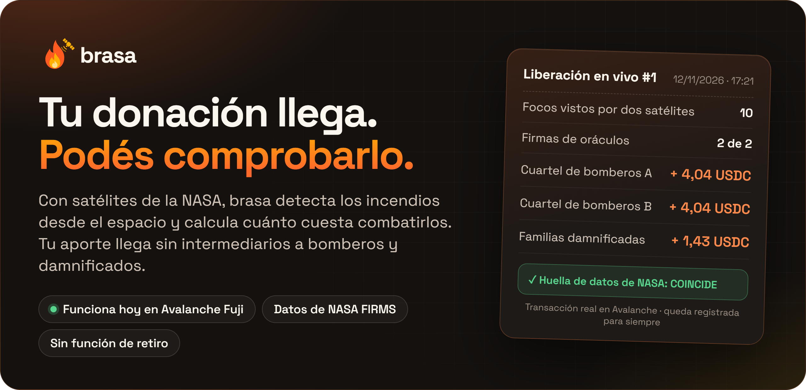
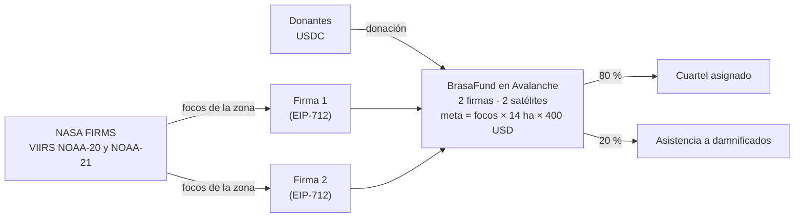

# brasa

**Cuando dos satélites de la NASA confirman un incendio, la donación llega en segundos al cuartel de bomberos que lo combate y a las familias afectadas. Cada dólar queda a la vista.**

<a href="https://brasafund.vercel.app"></a>

> **Prototipo en red de prueba.** Corre en Avalanche Fuji con USDC de prueba. Los datos de incendios son reales (NASA FIRMS) y el pago del 12/11/2026 se hizo con esos datos.

## Links

| | |
|---|---|
| **Web** | [brasafund.vercel.app](https://brasafund.vercel.app): mapa de incendios, el fondo y cómo donar |
| **Video** | [youtu.be/Kv2nUGe9D3A](https://youtu.be/Kv2nUGe9D3A) |
| **Pago en vivo** | [Comprobante del 12/11/2026](https://build.avax.network/explorer/fuji/c-chain/tx/0xd35e6748a10d21081a05998893f4b3d8d2f42d2d89d438bcd22944d7edded4a3): 10 focos confirmados, 9,5 USDC a dos cuarteles y a familias damnificadas |
| **Contrato** | [`BrasaFund` en Fuji](https://build.avax.network/explorer/fuji/c-chain/address/0x96b950d62Cae3eE39c5325144c78d0CBDA9d6057), código [verificado en Sourcify](https://sourcify.dev/server/repo-ui/43113/0x96b950d62Cae3eE39c5325144c78d0CBDA9d6057) |
| **Validación** | [Entrevista al Comandante Mayor del Cuartel de Bomberos Voluntarios de Salta](docs/producto/VALIDACION-BOMBEROS.md) |
| **Presentación** | [Deck](docs/presentacion/brasa-deck.pdf) · [Resumen en una página](docs/presentacion/one-pager.pdf) |
| **Documentación** | [Índice](docs/README.md) |

## Qué hace

1. **Detecta.** Baja los focos de calor de NASA FIRMS y exige que dos satélites (VIIRS NOAA-20 y NOAA-21) vean el mismo fuego, a menos de 2 km.
2. **Calcula.** Pone un costo a cada incendio con una regla pública: `focos × 14 ha × 400 USD por hectárea` (280 combate, 40 logística, 80 asistencia). Cada número tiene su fuente en [`FORMULA-BRASA.md`](docs/producto/FORMULA-BRASA.md).
3. **Envía.** Dos personas firman el reporte por separado. El contrato reparte el saldo: el 80 % al cuartel que la federación asignó a ese incendio y el 20 % a la asistencia de damnificados.
4. **Muestra.** Cada donación y cada pago quedan en la cadena. Cada pago guarda la huella de los datos de la NASA, y cualquiera la puede recalcular.

## Por qué blockchain

| Pregunta | Respuesta |
|---|---|
| ¿Quién desconfía de quién? | El donante no sabe si su aporte llegó a quien apaga el fuego. El cuartel no sabe cuándo ni cuánto va a recibir. |
| ¿Qué resuelve la cadena? | La regla y el fondo viven en un contrato público **sin función de retiro**: nadie puede sacar el dinero para otra cosa, ni siquiera el equipo. |
| ¿Quién paga y quién cobra? | El donante aporta USDC desde cualquier país, desde 0,01. Cobran el cuartel asignado y la asistencia a damnificados. La comisión es de 5 %, fija en el contrato y visible antes de confirmar. |
| ¿Y si el dato miente? | Tienen que coincidir dos satélites y dos firmas. Un mismo dato paga una sola vez. La huella de los datos queda guardada y se puede verificar. |

## Correr

Con Node 22, sin claves ni `.env`:

```bash
cd contracts && npm ci && npx hardhat test        # 62 tests del contrato
cd ../relayer && npm ci && npm test               # 38 tests del oráculo
node src/index.mjs verificar-hash \
  --tx 0xd35e6748a10d21081a05998893f4b3d8d2f42d2d89d438bcd22944d7edded4a3 \
  --datos sample-data/en-vivo-2026-11-12          # COINCIDE: la huella del pago en vivo
cd ../web && npm ci && npm run build
```

Para probarlo de punta a punta en un nodo local o desplegarlo en Fuji: [`CORRER-EN-LOCAL.md`](docs/tecnico/CORRER-EN-LOCAL.md).

## Real vs simulado

| Real | Simulado o de prueba |
|---|---|
| Focos de NASA FIRMS (VIIRS NOAA-20 y NOAA-21, MODIS) y aviso de GOES-19 | USDC de prueba en Avalanche Fuji |
| Contrato desplegado y verificado, con donaciones y pagos en la cadena | Los dos cuarteles y la billetera de damnificados son billeteras de prueba |
| Pago en vivo del 12/11/2026 con datos del día | Las dos claves de firma y la billetera "federación" las opera el equipo |
| Entrevista de validación con el Comandante Mayor del Cuartel de Bomberos Voluntarios de Salta | |

## Contratos en Fuji

| | Dirección |
|---|---|
| `BrasaFund` v3, vigente | [`0x96b950d62Cae3eE39c5325144c78d0CBDA9d6057`](https://build.avax.network/explorer/fuji/c-chain/address/0x96b950d62Cae3eE39c5325144c78d0CBDA9d6057) |
| `BrasaFund` v2, el del pago en vivo | [`0xAABcd03bCfEE730633E1Fd69756E1923Db50c72f`](https://build.avax.network/explorer/fuji/c-chain/address/0xAABcd03bCfEE730633E1Fd69756E1923Db50c72f) |
| USDC de Fuji (Circle) | `0x5425890298aed601595a70AB815c96711a31Bc65` |

Qué cambió en el v3 y qué rechaza el contrato: [`CONTRATO-V3.md`](docs/tecnico/CONTRATO-V3.md) y [`docs/seguridad/LEEME.md`](docs/seguridad/LEEME.md).

## Arquitectura



## Estructura

```
contracts/   BrasaFund.sol, 62 tests y scripts de despliegue (Hardhat 3)
relayer/     el oráculo: baja FIRMS, cruza los dos satélites, firma y reporta (38 tests)
             sample-data/  focos reales guardados, incluidos los del pago en vivo
             deploy/       guía para correrlo en un servidor
web/         la web: mapa, fondo y donación (Next.js + Leaflet)
docs/        producto, técnico, seguridad, legal, presentación e identidad
```

## Límites

- **Red de prueba.** Falta auditoría externa antes de la red principal.
- **Las firmas las opera el equipo.** El paso siguiente es una firma para la federación de bomberos y otra para un operador externo. El contrato ya lo permite, sin mover el fondo.
- **Los datos de FIRMS llegan con unas 3 horas de demora.** El pago sale en segundos desde que se firma.
- **Un pago no se puede revertir.** El control está antes del pago. Pagar por tramos, contra comprobantes de gasto, está en el [roadmap](docs/producto/roadmap.md).
- **Un foco no siempre es un incendio forestal.** Qué se filtra y qué no: [`FOCOS-QUE-NO-SON-INCENDIOS.md`](docs/producto/FOCOS-QUE-NO-SON-INCENDIOS.md).

## Equipo

[Juan Facundo Ayala](https://github.com/jfacundoayala) y [Gastón Persoglia](https://github.com/grancobud). Hecho en Chaco, Argentina, para el Hackathon Argentina Space 2026. Usamos Claude Code como asistente de programación.

## Licencia y atribuciones

Código bajo licencia [MIT](LICENSE). El nombre "brasa" y el logo no están incluidos en la licencia.

Focos: NASA FIRMS (LANCE). Alerta temprana: GOES-19 (NOAA), vía el programa Queimadas del INPE. Clima: Open-Meteo. Mapa: © OpenStreetMap. Límite de Salta: geoBoundaries (CC BY 2.5).
