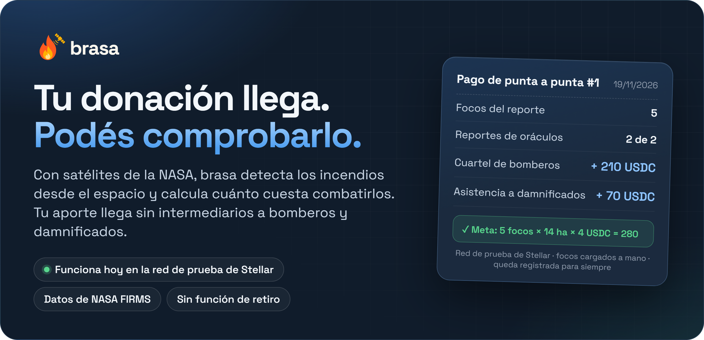
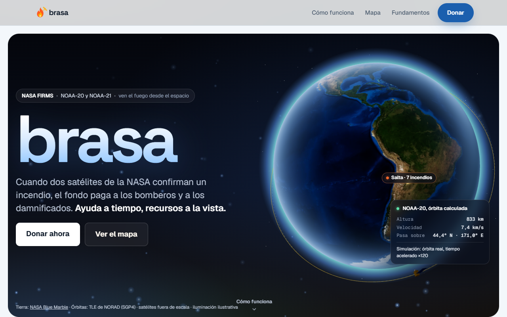
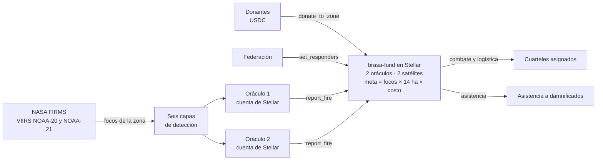

# brasa

> Cuando dos satélites de la NASA confirman un incendio, un contrato en Stellar envía la donación al cuartel de bomberos que lo combate y a las familias afectadas. Nadie puede retirar el fondo, y cada dólar queda a la vista.

**El problema.** En 2022 se quemaron cerca de 95.000 hectáreas de bosque en Salta. Hubo incendios activos durante 120 días, y las comunidades abrían cortafuegos a machete porque las autobombas no llegaban. Un solo incendio en el área metropolitana de Salta quemó más de 700 hectáreas con unas 100 personas trabajando, y nadie sabe cuánto costó. La ayuda llega por colectas que tardan días, y quien dona no ve adónde fue su aporte. Fuentes: [`DATOS-REALES-SALTA.md`](docs/producto/DATOS-REALES-SALTA.md).

**La propuesta.** Decidir antes del incendio cuánto se paga, cuándo y a quién, escribirlo en un contrato público y dejar que los datos de la NASA lo activen.

<a href="https://brasafund.vercel.app"></a>

**Detección temprana de incendios y donaciones sobre Stellar.** Prototipo en la red de prueba de Stellar, con USDC de prueba y datos reales de NASA FIRMS. Nació en el Hackathon Argentina Space 2026.

<a href="https://brasafund.vercel.app"></a>

## Links

- **Web:** [brasafund.vercel.app](https://brasafund.vercel.app). Muestra el mapa con los últimos focos de Salta que vio la NASA, la meta de cada incendio con la fuente de cada número, el fondo y la donación desde la billetera. La explicación técnica está en [`/fundamentos`](https://brasafund.vercel.app/fundamentos).
- **Contrato:** `brasa-fund` [`CAE2…VQR6`](https://stellar.expert/explorer/testnet/contract/CAE23TYOONXIZEHOYY4GZARITWVOFQBENRWHK7MCFM4Q7NRUJSVGVQR6) en la red de prueba de Stellar. El código está en [`stellar/`](stellar/).
- **Pago de punta a punta, 19/11/2026:** [dos reportes, uno por satélite, y el pago en la misma transacción](https://stellar.expert/explorer/testnet/tx/9789094c217e84c3aeb28836751057e77f98bc36a7056af1fd72b3fc445dd532).
- **Copia del pago:** la red de prueba se reinicia de vez en cuando, así que el pago y el contrato quedaron guardados en [`docs/img/evidencia/`](docs/img/evidencia/README.md), con capturas y los datos crudos de la transacción.
- **Validación:** [entrevista al Comandante Mayor del Cuartel de Bomberos Voluntarios de Salta](docs/producto/VALIDACION-BOMBEROS.md).
- **Demo guiada y preguntas difíciles:** [`DEMO.md`](docs/DEMO.md).
- **Presentación:** [deck](docs/presentacion/brasa-deck.pdf) y [resumen en una página](docs/presentacion/one-pager.pdf).

## Cómo funciona

1. **Zona.** La federación de bomberos crea la zona con `create_zone`. Ahí quedan fijos la huella del polígono, el mínimo de focos, la espera entre pagos, el tope por incendio y el costo por hectárea: 400 USD, de los que 280 son combate, 40 logística y 80 asistencia. Después ya no se pueden cambiar. También acredita cuarteles y entidades de asistencia, que pueden cobrar recién pasada una demora pública.
2. **Donación.** Cualquiera dona USDC con `donate_to_zone`, con una sola firma. `quote_split` muestra la comisión del 5 % antes de confirmar, y el donante puede cubrirla para que llegue el 100 %.
3. **Detección.** El oráculo ([`relayer/`](relayer/)) baja los focos de **NASA FIRMS** de VIIRS NOAA-20 y NOAA-21 y los pasa por seis capas antes de contar (ver abajo). Calcula la huella de los datos (`data_hash`, SHA-256) y arma un reporte por satélite.
4. **Asignación.** La federación indica con `set_responders` qué cuarteles combaten ese incendio, con un vencimiento de 30 días como máximo. Sin asignación, el fondo no paga.
5. **Pago.** Los dos reportes van juntos a `report_fire`. Cada oráculo es una cuenta de Stellar que autoriza solo su reporte, y la red impide usar dos veces la misma autorización. El contrato verifica la antigüedad de los datos (6 h como máximo, con 3 h de separación entre satélites) y comprueba que cada dato sea nuevo. Toma el menor de los dos conteos y calcula la meta: `focos × 14 ha × costo por hectárea`. Paga hasta esa meta: la parte de combate y logística a los cuarteles asignados y la de asistencia a las entidades de asistencia. Si un destinatario todavía no habilitó USDC en su cuenta, su parte queda en el fondo y los demás cobran igual.

### Seis capas para no pagar un fuego falso

| Capa | Qué deja afuera |
|---|---|
| 1. Alta confianza | Los focos que la propia NASA marca como dudosos |
| 2. Fuentes fijas | Chimeneas, ingenios y otros puntos que se repiten año tras año en el historial |
| 3. Uso del suelo | Los focos sobre cultivos, donde suele haber quemas agrícolas (mapa ESA WorldCover) |
| 4. Incendio | Los focos sueltos: se cuentan grupos a menos de 2 km entre sí |
| 5. Dos satélites | Lo que vio uno solo: vale el menor de los dos conteos |
| 6. Persistencia | Lo que se vio un solo día: el incendio tiene que verse en dos días distintos |

Un incendio que todavía no cumple la persistencia queda en espera y se vuelve a mirar en la pasada siguiente.

**Resultados:**
- **Prueba histórica:** con los focos de Salta de 2012 a 2025, las capas bajan los días con pago posible de 1.088 a 110.
- **Pago de punta a punta en Stellar, 19/11:** dos reportes de 6 y 5 focos, el contrato tomó 5 y calculó la meta. El fondo de la zona pasó de 950 a 670 USDC en una transacción: 210 al cuartel y 70 a la asistencia. Ese día no había incendios en Salta, así que los focos de la prueba se cargaron a mano; con los datos reales del día el oráculo contó cero y no envió nada.
- **Tests:** 32 del contrato y 63 del oráculo.

## Por qué blockchain

| Pregunta | Respuesta |
|---|---|
| ¿Quién desconfía de quién? | El donante no sabe si su aporte llegó a quien apaga el fuego. El cuartel no sabe cuándo ni cuánto va a recibir. |
| ¿Qué evento libera el pago en la cadena? | Dos reportes, uno por satélite, que confirman el mismo fuego. `report_fire` calcula la meta y paga en la misma transacción. |
| ¿Qué pasa si el dato miente? | Tienen que coincidir dos satélites y dos oráculos, y un mismo dato paga una sola vez. La meta funciona como techo y hay una espera entre pagos. La huella queda guardada, y cualquiera puede comprobar después qué dato se usó. |
| ¿Quién paga y quién cobra? | Pagan los donantes, desde cualquier país. Cobran los cuarteles asignados y la asistencia a damnificados. La comisión de 5 % es fija en el contrato y queda a la vista. |

Sin la cadena, el donante dependería de la palabra de quien organiza la colecta. Con ella, la regla y el saldo son públicos, y el contrato no tiene función de retiro: nadie puede llevarse el fondo, tampoco el equipo.

**Por qué Stellar.** Un pago se confirma en segundos y cuesta una fracción de centavo, así que una donación chica llega casi entera. USDC existe en la red como moneda nativa, y un cuartel cobra en una cuenta común, sin desplegar nada. La donación es una sola firma desde cualquier billetera de Stellar.

## Correr

Contrato (Rust, con la [CLI de Stellar](https://developers.stellar.org/docs/tools/cli)):

```bash
cd stellar
cargo test                # 32 tests
stellar contract build    # target/wasm32v1-none/release/brasa_fund.wasm
```

Oráculo y web, con Node 22, sin claves ni `.env`:

```bash
npm run instalar          # dependencias
npm run test:relayer      # 63 tests del oráculo
```

Ver qué contaría hoy el oráculo con los datos públicos de la NASA, sin enviar nada:

```bash
cd relayer
node src/index.mjs reportar-stellar --publico --simular
```

Más detalle: [`stellar/README.md`](stellar/README.md).

## Real vs simulado

| Real | Simulado o de prueba |
|---|---|
| Focos de NASA FIRMS (VIIRS NOAA-20 y NOAA-21, MODIS) y aviso de GOES-19 | USDC de prueba emitido por el equipo, sin valor |
| Contrato desplegado en la red de prueba de Stellar, con donaciones y pagos en la cadena | El cuartel y la entidad de asistencia son cuentas de prueba |
| Prueba histórica con los focos de Salta de 2012 a 2025 | Los focos del pago del 19/11 se cargaron a mano |
| Costo por hectárea con fuentes oficiales, acordado en la entrevista de validación | La zona de prueba usa montos chicos: 4 USDC por hectárea y tope de 500 por incendio |
| | Los dos oráculos y la federación los opera el equipo. Las demoras son de 1 hora (en el piloto, 48 h y 72 h) |

## En Stellar (red de prueba)

| Qué | Dirección |
|---|---|
| Contrato `brasa-fund` | [`CAE23TYOONXIZEHOYY4GZARITWVOFQBENRWHK7MCFM4Q7NRUJSVGVQR6`](https://stellar.expert/explorer/testnet/contract/CAE23TYOONXIZEHOYY4GZARITWVOFQBENRWHK7MCFM4Q7NRUJSVGVQR6) |
| USDC de prueba | [`CAHM3B3MQMPOQLD6IC4UH77AGEVSXQEQCHHGM3SL2J2DJXCEFIRTESO3`](https://stellar.expert/explorer/testnet/contract/CAHM3B3MQMPOQLD6IC4UH77AGEVSXQEQCHHGM3SL2J2DJXCEFIRTESO3) |
| Federación | `GCBB27NIZY2M2VRMKFJIGFBHWYQMQ73BVKIQ2VOPKDLVAU36VLE337GL` |

Medidas de seguridad: [`SECURITY.md`](SECURITY.md) y [`docs/seguridad/`](docs/seguridad/LEEME.md).

## Arquitectura



## Estructura

```
stellar/     el contrato brasa-fund (Rust) y sus 32 tests
relayer/     el oráculo
  src/         firms.mjs (baja y filtra FIRMS), capas.mjs (las seis capas), incendios.mjs (agrupa
               y cruza los satélites), stellar.mjs (arma y envía los reportes), verificar.mjs (huella),
               retroprueba.mjs (prueba histórica), index.mjs (comandos)
  analisis/    cómo se arma el mapa de uso del suelo
  sample-data/ focos reales guardados y los mapas de fuentes fijas y uso del suelo
web/         Next.js + MapLibre + React Three Fiber + Stellar Wallets Kit
  lib/         stellar.ts (lectura del contrato y donación), formula.ts (meta por incendio),
               goes.ts (avisos GOES-19), cuarteles.ts, zonas.ts, orbita.ts
docs/        producto, técnico, seguridad, legal, presentación e identidad
avalanche/   la primera versión del contrato, en Solidity (ver abajo)
.github/     plantilla de pull request y el revisor de enlaces
```

## Límites

- **Red de prueba.** Antes de la red principal falta una auditoría externa.
- **Los oráculos los opera el equipo.** Lo que sigue es uno para la federación de bomberos y otro para un operador externo. El contrato ya permite rotarlos sin mover el fondo.
- **La huella no frena un dato falso: permite detectarlo después.** Si los dos oráculos mienten a la vez, el contrato paga, pero como mucho la meta y solo a destinatarios acreditados.
- **Los datos de FIRMS llegan con unas 3 horas de demora, y la persistencia pide dos días.** Lo que se acorta son los días de una colecta: desde que se reporta, el pago sale en segundos.
- **El mapa de uso del suelo no distingue una pastura sembrada de un pastizal.** Qué se filtra y qué no: [`FOCOS-QUE-NO-SON-INCENDIOS.md`](docs/producto/FOCOS-QUE-NO-SON-INCENDIOS.md).
- **La cadena muestra a quién llegó cada dólar, no en qué se gastó.** Pagar por tramos contra comprobantes está en el [roadmap](docs/producto/roadmap.md).

## Primera versión

La primera versión del contrato se escribió en Solidity y se probó en Avalanche Fuji durante el hackathon. Con ella se hizo, el 12/11/2026, un pago con datos reales del día: los dos satélites confirmaron 10 focos y el fondo pagó en una transacción a dos cuarteles y a la asistencia. El código sigue en [`avalanche/`](avalanche/), con sus 116 tests, y las direcciones y transacciones en [`DIRECCIONES.md`](docs/tecnico/DIRECCIONES.md). El [video](https://youtu.be/Kv2nUGe9D3A) muestra esa versión.

## Estado a noviembre de 2026

- **Funciona:** el contrato en la red de prueba de Stellar, el oráculo con datos reales de la NASA, la web con mapa, donación desde la billetera y un pago de punta a punta.
- **Escrito y probado, todavía sin desplegar:** una pausa de emergencia. Una cuenta guardiana, distinta de la federación, puede frenar los pagos por reporte hasta 7 días si un oráculo falla. No puede mover dinero, la pausa vence sola y las donaciones siguen entrando. Tiene 35 tests.
- **Lo que sigue:** el [roadmap](docs/producto/roadmap.md).

## Equipo

[Juan Facundo Ayala](https://github.com/jfacundoayala) y [Gastón Persoglia](https://github.com/grancobud). Hecho en Chaco, Argentina. Usamos asistentes de programación con IA.

## Licencia y atribuciones

Código bajo licencia [MIT](LICENSE). El nombre "brasa" y el logo no están incluidos en la licencia.

Focos: NASA FIRMS (LANCE). Alerta temprana: GOES-19 (NOAA), vía el programa Queimadas del INPE. Uso del suelo: ESA WorldCover 2021 (CC BY 4.0). Clima: Open-Meteo. Mapa: imagen satelital Esri World Imagery (Esri, Vantor, Earthstar Geographics), nombres de Esri con datos de © OpenStreetMap contributors, relieve AWS Terrain Tiles (Mapzen). Tierra 3D: NASA Blue Marble. Órbitas: TLE de NORAD (SGP4, satellite.js). Límite de Salta: geoBoundaries (CC BY 2.5).
