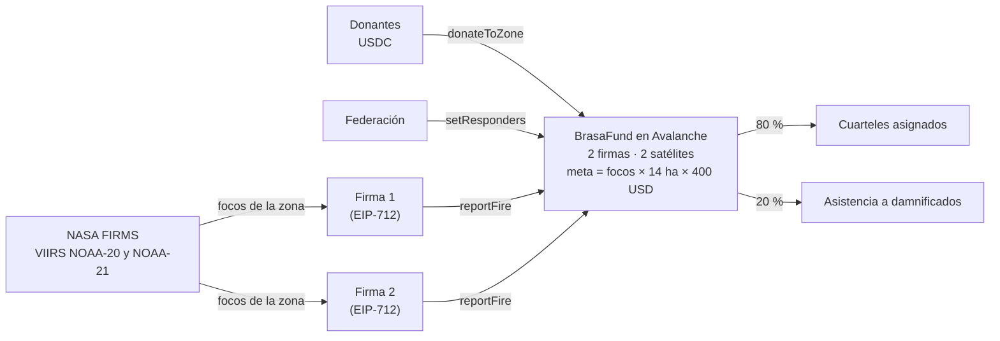

# brasa

> Cuando dos satélites de la NASA confirman un incendio, un contrato en Avalanche envía la donación al cuartel de bomberos que lo combate y a las familias afectadas. Nadie puede retirar el fondo, y cada dólar queda a la vista.

**El problema.** En 2022 se quemaron cerca de 95.000 hectáreas de bosque en Salta. Hubo incendios activos durante 120 días, y las comunidades abrían cortafuegos a machete porque las autobombas no llegaban. Un solo incendio en el área metropolitana de Salta quemó más de 700 hectáreas con unas 100 personas trabajando, y nadie sabe cuánto costó. La ayuda llega por colectas que tardan días, y quien dona no ve adónde fue su aporte. Fuentes: [`DATOS-REALES-SALTA.md`](docs/producto/DATOS-REALES-SALTA.md).

**La propuesta.** Decidir antes del incendio cuánto se paga, cuándo y a quién, escribirlo en un contrato público y dejar que los datos de la NASA lo activen.

<a href="https://brasafund.vercel.app"></a>

**Hackathon Argentina Space 2026** · Track Avalanche · Geoespacial · Prototipo en Avalanche Fuji, con USDC de prueba y datos reales de NASA FIRMS.

## Links

- **Web en vivo:** [brasafund.vercel.app](https://brasafund.vercel.app). Muestra el mapa con los focos de Salta del día, la meta de cada incendio con la fuente de cada número, el fondo y la donación desde la billetera. La explicación técnica está en [`/fundamentos`](https://brasafund.vercel.app/fundamentos).
- **Contrato:** `BrasaFund` [`0x96b9…6057`](https://build.avax.network/explorer/fuji/c-chain/address/0x96b950d62Cae3eE39c5325144c78d0CBDA9d6057) en Avalanche Fuji (43113), con el código [verificado en Sourcify](https://sourcify.dev/server/repo-ui/43113/0x96b950d62Cae3eE39c5325144c78d0CBDA9d6057).
- **Pago en vivo, 12/11/2026:** [dos firmas, una por satélite, y el pago en la misma transacción](https://build.avax.network/explorer/fuji/c-chain/tx/0xd35e6748a10d21081a05998893f4b3d8d2f42d2d89d438bcd22944d7edded4a3). Todas las transacciones están en [`DIRECCIONES.md`](docs/tecnico/DIRECCIONES.md).
- **Video:** [youtu.be/Kv2nUGe9D3A](https://youtu.be/Kv2nUGe9D3A).
- **Validación:** [entrevista al Comandante Mayor del Cuartel de Bomberos Voluntarios de Salta](docs/producto/VALIDACION-BOMBEROS.md).
- **Demo guiada y preguntas difíciles:** [`DEMO.md`](docs/DEMO.md).
- **Presentación:** [deck](docs/presentacion/brasa-deck.pdf) y [resumen en una página](docs/presentacion/one-pager.pdf).

## Cómo funciona

1. **Zona.** La federación de bomberos crea la zona con `createZone`. Ahí quedan fijos la huella del polígono, el mínimo de focos, la espera entre pagos, el tope por incendio y el costo por hectárea: 400 USD, de los que 280 son combate, 40 logística y 80 asistencia. Después ya no se pueden cambiar. También acredita cuarteles y entidades de asistencia, que pueden cobrar recién pasada una demora pública.
2. **Donación.** Cualquiera dona USDC con `donateToZone`, desde 0,01. `quoteSplit` muestra la comisión del 5 % antes de confirmar, y el donante puede cubrirla para que llegue el 100 %.
3. **Detección.** El oráculo ([`relayer/`](relayer/)) baja los focos de **NASA FIRMS** de VIIRS NOAA-20 y NOAA-21. Se queda con los de alta confianza dentro del polígono y cuenta solo los que el otro satélite también vio a menos de 2 km. Calcula la huella de los datos (`dataHash`, SHA-256) y cada clave firma su reporte por separado ([EIP-712](https://eips.ethereum.org/EIPS/eip-712)).
4. **Asignación.** La federación indica con `setResponders` qué cuarteles combaten ese incendio, con un vencimiento de 30 días como máximo. Sin asignación, el fondo no paga.
5. **Pago.** Cualquiera puede enviar los dos reportes a `reportFire`. El contrato verifica las dos firmas y la antigüedad de los datos (6 h como máximo, con 3 h de separación entre satélites), y comprueba que cada dato sea nuevo. Toma el menor de los dos conteos y calcula la meta: `focos × 14 ha × 400 USD`. Paga hasta esa meta: 80 % entre los cuarteles asignados y 20 % a la asistencia. Si una billetera rechaza el pago, ese monto vuelve al fondo y los demás cobran igual.

**Resultados:**
- **Pago en vivo del 12/11:** los dos satélites confirmaron 10 focos, y la meta fue de 44.800 USD con la regla del contrato v2, de 320 USD por hectárea. El fondo tenía 9,5 USDC y los pagó en una transacción: 8,075 a dos cuarteles y 1,425 a la asistencia.
- **Huella:** `verificar-hash` recalcula el `dataHash` de ese pago a partir de los datos guardados en el repo y da **COINCIDE**.
- **Tests:** 100 en verde, 62 del contrato y 38 del oráculo. Corren en cada cambio, junto con una búsqueda de claves privadas.

## Por qué blockchain

| Pregunta del track | Respuesta |
|---|---|
| ¿Quién desconfía de quién? | El donante no sabe si su aporte llegó a quien apaga el fuego. El cuartel no sabe cuándo ni cuánto va a recibir. |
| ¿Qué evento dispara algo en la cadena? | Dos reportes firmados, uno por satélite, que confirman el mismo fuego. `reportFire` calcula la meta y paga en la misma transacción. |
| ¿Qué pasa si el dato miente? | Tienen que coincidir dos satélites y dos firmas, y un mismo dato paga una sola vez. La meta funciona como techo y hay 12 h entre pagos. La huella queda guardada, y cualquiera puede comprobar después qué dato se usó. |
| ¿Quién paga y quién cobra? | Pagan los donantes, desde cualquier país y desde 0,01 USDC. Cobran los cuarteles asignados y la asistencia a damnificados. La comisión de 5 % es fija en el contrato y queda a la vista. |

Sin la cadena, el donante dependería de la palabra de quien organiza la colecta. Con ella, la regla y el saldo son públicos, y el contrato no tiene función de retiro: nadie puede llevarse el fondo, tampoco el equipo.

## Correr

Con Node 22, sin claves ni `.env`:

```bash
npm run instalar        # dependencias de contracts, relayer y web
npm test                # 62 tests del contrato (Hardhat 3) y 38 del oráculo
```

Verificar el pago en vivo con los datos guardados:

```bash
cd relayer
node src/index.mjs verificar-hash \
  --tx 0xd35e6748a10d21081a05998893f4b3d8d2f42d2d89d438bcd22944d7edded4a3 \
  --datos sample-data/en-vivo-2026-11-12        # COINCIDE, por sensor
```

De punta a punta en un nodo local:

```bash
cd contracts && npx hardhat node                          # terminal 1
cd contracts && NETWORK=local node scripts/deploy.mjs     # terminal 2: despliega y crea la zona
cd relayer && node src/index.mjs preparar                 # prepara los focos para el mapa
cd relayer && LOCAL_DEMO=1 node src/index.mjs reportar    # firma los dos reportes y libera
cd web && npm run dev                                     # http://localhost:3000
```

Para desplegarlo en Fuji: [`CORRER-EN-LOCAL.md`](docs/tecnico/CORRER-EN-LOCAL.md).

## Real vs simulado

| Real | Simulado o de prueba |
|---|---|
| Focos de NASA FIRMS (VIIRS NOAA-20 y NOAA-21, MODIS) y aviso de GOES-19 | USDC de prueba en Avalanche Fuji |
| Contrato desplegado y verificado, con donaciones y pagos en la cadena | Los dos cuarteles y la billetera de asistencia son billeteras de prueba |
| Pago en vivo del 12/11/2026 con datos del día | Las dos claves de firma y la federación las opera el equipo |
| Costo por hectárea con fuentes oficiales, acordado en la entrevista de validación | Las demoras son de 10 minutos para mostrarlas en vivo (en el piloto, 48 h y 72 h) |

## En Avalanche Fuji

| Contrato | Dirección | Estado |
|---|---|---|
| `BrasaFund` v3 | [`0x96b950d62Cae3eE39c5325144c78d0CBDA9d6057`](https://build.avax.network/explorer/fuji/c-chain/address/0x96b950d62Cae3eE39c5325144c78d0CBDA9d6057) | Vigente. Paga solo a cuarteles asignados, rota claves de a una y no paga dos veces el mismo dato |
| `BrasaFund` v2 | [`0xAABcd03bCfEE730633E1Fd69756E1923Db50c72f`](https://build.avax.network/explorer/fuji/c-chain/address/0xAABcd03bCfEE730633E1Fd69756E1923Db50c72f) | El del pago en vivo del 12/11 |
| USDC (Circle) | `0x5425890298aed601595a70AB815c96711a31Bc65` | USDC nativo de Fuji |

Qué cambió en el v3: [`CONTRATO-V3.md`](docs/tecnico/CONTRATO-V3.md). Medidas de seguridad y qué test comprueba cada una: [`SECURITY.md`](SECURITY.md) y [`docs/seguridad/`](docs/seguridad/LEEME.md).

## Arquitectura



## Estructura

```
contracts/   BrasaFund.sol, 62 tests y scripts de despliegue, donación y asignación (Hardhat 3)
relayer/     el oráculo
  src/         firms.mjs (baja y filtra FIRMS), incendios.mjs (cruza los satélites),
               reporte.mjs (firma EIP-712), verificar.mjs (huella), index.mjs (comandos)
  sample-data/ focos reales guardados, incluidos los del pago en vivo
  deploy/      cómo correrlo en un servidor
web/         Next.js + Leaflet + ethers
  lib/         formula.ts (meta por incendio), goes.ts (avisos GOES-19), cuarteles.ts, zonas.ts
docs/        producto, técnico, seguridad, legal, presentación e identidad
.github/     tests y búsqueda de claves en cada cambio; actualización de datos de la NASA
```

## Límites

- **Red de prueba.** Antes de la red principal falta una auditoría externa.
- **Las firmas las opera el equipo.** Lo que sigue es una firma para la federación de bomberos y otra para un operador externo. El contrato ya permite rotarlas sin mover el fondo.
- **La huella no frena un dato falso: permite detectarlo después.** Si las dos firmas mienten a la vez, el contrato paga, pero como mucho la meta y solo a destinatarios acreditados.
- **Los datos de FIRMS llegan con unas 3 horas de demora.** Lo que se acorta son los días de una colecta: desde que se firma, el pago sale en segundos.
- **La cadena muestra a quién llegó cada dólar, no en qué se gastó.** Pagar por tramos contra comprobantes está en el [roadmap](docs/producto/roadmap.md).
- **Un foco no siempre es un incendio forestal.** Qué se filtra y qué no: [`FOCOS-QUE-NO-SON-INCENDIOS.md`](docs/producto/FOCOS-QUE-NO-SON-INCENDIOS.md).

## Equipo

[Juan Facundo Ayala](https://github.com/jfacundoayala) y [Gastón Persoglia](https://github.com/grancobud). Hecho en Chaco, Argentina. Usamos Claude Code como asistente de programación.

## Licencia y atribuciones

Código bajo licencia [MIT](LICENSE). El nombre "brasa" y el logo no están incluidos en la licencia.

Focos: NASA FIRMS (LANCE). Alerta temprana: GOES-19 (NOAA), vía el programa Queimadas del INPE. Clima: Open-Meteo. Mapa: © OpenStreetMap. Límite de Salta: geoBoundaries (CC BY 2.5).
